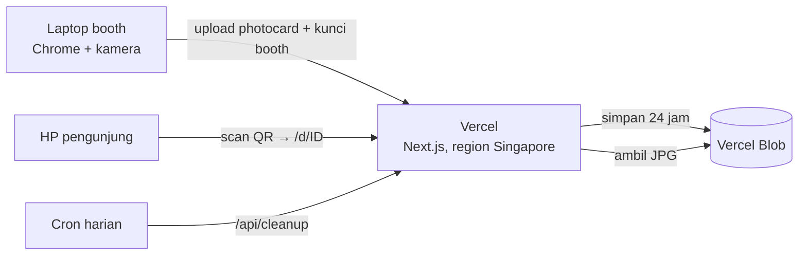

<!-- @format -->

# Tutorial Deploy CIA Photobooth ke Vercel

Panduan lengkap dari kode di laptop sampai photobooth online di `https://nama-project.vercel.app`. Setelah selesai:

- laptop booth cukup membuka website di Chrome, tanpa install apa pun;
- photocard tersimpan online (Vercel Blob) selama 24 jam;
- pengunjung scan QR dan mengunduh foto **dengan data seluler**, tidak perlu satu Wi-Fi dengan booth.

Semua langkah memakai paket **Hobby (gratis)** dari Vercel. Waktu yang dibutuhkan sekitar 30 menit.

## Daftar Isi

1. [Gambaran sistem](#1-gambaran-sistem)
2. [Yang perlu disiapkan](#2-yang-perlu-disiapkan)
3. [Kirim kode ke GitHub (branch main)](#3-kirim-kode-ke-github-branch-main)
4. [Import project ke Vercel](#4-import-project-ke-vercel)
5. [Buat Blob store untuk foto](#5-buat-blob-store-untuk-foto)
6. [Isi environment variables](#6-isi-environment-variables)
7. [Deploy ulang](#7-deploy-ulang)
8. [Aktifkan laptop booth](#8-aktifkan-laptop-booth)
9. [Uji coba sebelum acara](#9-uji-coba-sebelum-acara)
10. [Checklist hari H](#10-checklist-hari-h)
11. [Mengubah desain atau logo setelah deploy](#11-mengubah-desain-atau-logo-setelah-deploy)
12. [Alternatif: deploy lewat Vercel CLI](#12-alternatif-deploy-lewat-vercel-cli)
13. [Alternatif tanpa internet: mode Wi-Fi lokal](#13-alternatif-tanpa-internet-mode-wi-fi-lokal)
14. [Batas paket gratis](#14-batas-paket-gratis)
15. [Troubleshooting](#15-troubleshooting)

## 1. Gambaran sistem



- Foto mentah tidak pernah diunggah; foto itu tetap di browser laptop booth (IndexedDB). Yang diunggah hanya photocard final (JPG ≤ 4 MB).
- AI hand tracking berjalan di laptop booth (Web Worker), bukan di server, jadi tidak memakai kuota Vercel.
- Upload dikunci dengan `BOOTH_ACCESS_KEY`. Orang lain yang membuka website tidak bisa mengunggah foto.
- Link QR berlaku 24 jam. Cron harian menghapus foto yang sudah lewat masa berlaku.
- Fungsi server berjalan di Singapura (`sin1`, diatur di [vercel.json](../vercel.json)), region terdekat dari Makassar.

## 2. Yang perlu disiapkan

| Kebutuhan    | Keterangan                                                                                                                                  |
| ------------ | ------------------------------------------------------------------------------------------------------------------------------------------- |
| Akun GitHub  | Pemilik repo `Rangga-WebDev/DTCPhotoSBooth`, atau akun yang punya akses push.                                                              |
| Akun Vercel  | Daftar di [vercel.com/signup](https://vercel.com/signup) dengan **Continue with GitHub**. Paket Hobby gratis untuk penggunaan non-komersial. |
| Laptop booth | Chrome/Edge terbaru, webcam, internet stabil (Wi-Fi acara + hotspot cadangan), printer 4R (opsional).                                       |
| Git          | Untuk mengirim kode ke GitHub. Node.js 20.9+ (disarankan 24 LTS) hanya perlu kalau mau menguji di laptop atau memakai CLI.                 |

## 3. Kirim kode ke GitHub (branch `main`)

Vercel men-deploy **Production** dari branch `main`. Branch lain hanya menjadi deployment **Preview** yang dilindungi login Vercel, jadi QR-nya tidak bisa dibuka pengunjung.

Perubahan CIA dan desain HMS-FT ada di branch `rangga-webdev-cia-civil-in-action-rebrand`. Kirim branch itu lalu gabungkan ke `main`:

```powershell
cd "lokasi\folder\project"
git push -u origin rangga-webdev-cia-civil-in-action-rebrand
gh pr create --base main --title "CIA Photobooth + desain HMS-FT" --fill
gh pr merge --merge
```

Kalau tidak memakai `gh`: buka repo di GitHub → **Compare & pull request** → **Create pull request** → **Merge pull request**.

Yang harus ada di `main`: `public/models/gesture_recognizer.task`, `public/logo/`, `vercel.json`, dan `package-lock.json`. Folder `public/mediapipe/` memang **tidak** di-commit; Vercel membuatnya otomatis saat build.

> Jangan pernah commit `.env.local`, token, atau kunci rahasia.

## 4. Import project ke Vercel

1. Buka [vercel.com/new](https://vercel.com/new).
2. Di **Import Git Repository**, pilih `DTCPhotoSBooth` → **Import**. Kalau repo tidak muncul, klik **Adjust GitHub App Permissions** dan beri akses ke repo itu.
3. **Project Name**: misalnya `cia-photobooth`. Nama ini menjadi domain `https://cia-photobooth.vercel.app`. Kalau nama sudah dipakai orang lain, domainnya berbeda; domain final terlihat di **Settings → Domains**.
4. **Framework Preset**: Next.js (terdeteksi otomatis). Root Directory `./`. **Jangan ubah** Build Command dan Output Directory: Vercel menjalankan `npm run build`, yang otomatis menjalankan `prebuild` untuk menyalin file AI MediaPipe.
5. Klik **Deploy** dan tunggu 1–3 menit sampai deployment selesai.

Website sudah bisa dibuka, tapi upload foto dan QR **belum** jalan sampai langkah 5–7 selesai. Itu normal.

> Opsional: **Settings → Build and Deployment → Node.js Version** → **24.x**, versi yang dipakai saat pengujian. Default Vercel (LTS terbaru) juga bisa dipakai.

## 5. Buat Blob store untuk foto

1. Buka tab **Storage** di dashboard Vercel, buat store baru, lalu pilih **Blob**.
2. Isi nama, misalnya `cia-photobooth-foto`.
3. **Region**: pilih **Singapore (sin1)**, sama dengan region fungsi server.
4. **Access**: pilih **Private**. Foto hanya bisa diambil lewat server photobooth. Pilihan akses **tidak bisa diubah** setelah store dibuat.
5. Di halaman store, bagian **Connections** → **Connect to Project** → pilih project `cia-photobooth`, centang environment **Production** dan **Preview** → **Connect**.

Berhasil kalau tabel **Connections** menampilkan `cia-photobooth` dengan info `BLOB_STORE_ID` dan `BLOB_WEBHOOK_PUBLIC_KEY`, environment **Production, Preview**. Aplikasi otomatis memakai `BLOB_STORE_ID` (autentikasi OIDC), jadi tidak ada token yang perlu disalin.

> Kotak oranye _"All connected projects use OIDC… Revoke Token"_ hanya saran keamanan. **Abaikan saja**. Kalau mau, token itu boleh di-revoke **setelah** langkah 7 (deploy ulang) dan uji coba berhasil, karena aplikasi tidak memakainya.

## 6. Isi environment variables

Buka **Settings → Environment Variables**, lalu tambahkan satu per satu (Environment: **Production**; boleh juga Preview):

| Key                    | Value                                                                                                  | Wajib?                                           |
| ---------------------- | ------------------------------------------------------------------------------------------------------ | ------------------------------------------------ |
| `BOOTH_ACCESS_KEY`     | Kunci acak panjang (cara membuat ada di bawah tabel)                                                   | **Wajib**. Tanpa kunci, upload ditolak.          |
| `CRON_SECRET`          | Rahasia acak lain                                                                                      | Disarankan, untuk cron pembersih foto.           |
| `NEXT_PUBLIC_SITE_URL` | Domain dari **Settings → Domains**, misalnya `https://cia-photobooth.vercel.app` (tanpa `/` di akhir) | Disarankan. QR selalu memakai domain publik ini. |
| `BLOB_ACCESS`          | `public`, hanya kalau Blob store dibuat **Public**                                                     | Opsional (default `private`).                    |

Membuat kunci acak di PowerShell (jalankan dua kali, untuk `BOOTH_ACCESS_KEY` dan `CRON_SECRET`):

```powershell
$bytes = New-Object byte[] 24
[System.Security.Cryptography.RandomNumberGenerator]::Create().GetBytes($bytes)
-join ($bytes | ForEach-Object { $_.ToString("x2") })
```

Simpan `BOOTH_ACCESS_KEY` di catatan panitia karena dibutuhkan di langkah 8. Jangan bagikan ke publik.

**Jangan** isi `NEXT_PUBLIC_DOWNLOAD_MODE` atau `NEXT_PUBLIC_LOCAL_URL` di Vercel; di sana mode QR otomatis `site`.

## 7. Deploy ulang

Perubahan environment variable hanya berlaku untuk deployment **baru**:

1. Tab **Deployments** → deployment teratas → ikon **⋯** → **Redeploy** → konfirmasi **Redeploy**.
2. Tunggu sampai status **Ready**.

Ulangi langkah ini setiap kali mengubah environment variable.

## 8. Aktifkan laptop booth

Lakukan sekali di laptop booth, memakai browser dan profil yang sama dengan saat acara. **Jangan** pakai mode Incognito, karena kunci hilang saat jendela ditutup.

1. Buka `https://cia-photobooth.vercel.app/?key=ISI_BOOTH_ACCESS_KEY`. Muncul pesan _"Kunci booth tersimpan di browser ini…"_ dan kunci langsung hilang dari address bar.
2. Masih di halaman utama, klik **Mode pameran**: layar penuh dan layar tetap menyala. Tombol ini hanya ada di halaman utama; layar penuh tetap aktif saat pindah ke halaman kamera.
3. Mulai sesi sampai halaman kamera. Izinkan kamera (ikon gembok di address bar → Camera → Allow).
4. Di halaman kamera, klik tombol **Cek perangkat** dan pastikan isinya:

   | Item                  | Harus                                                 |
   | --------------------- | ----------------------------------------------------- |
   | Link QR               | `WEBSITE`, detail `https://cia-photobooth.vercel.app` |
   | Penyimpanan           | `VERCEL BLOB`                                         |
   | Kunci booth           | `OK`                                                  |
   | Kamera, Server, Suara | `SIAP`                                                |

   Kalau semua beres, tombolnya berubah menjadi **Semua siap**.

> Selalu buka booth lewat domain produksi (`cia-photobooth.vercel.app` atau domain sendiri). URL deployment yang panjang, seperti `cia-photobooth-abc123-namaakun.vercel.app`, dilindungi login Vercel (_Deployment Protection_).

## 9. Uji coba sebelum acara

1. Jalankan satu sesi penuh: pilih jumlah foto → hand sign → pilih desain (coba juga kelompok **HMS-FT Unismuh Makassar**) → QR muncul.
2. Scan QR dengan HP yang memakai **data seluler**, bukan Wi-Fi booth. Halaman unduhan harus terbuka **tanpa login**, lalu tombol simpan mengunduh JPG.
3. Di Vercel, buka **Storage** → store Blob → file baru ada di folder `cia-photobooth/photos/`.
4. Cetak satu photocard 4R: kertas 4 × 6 in, skala 100%, tanpa margin, header/footer browser mati.
5. Cek **Settings → Cron Jobs**: `/api/cleanup` terdaftar. Jadwal `0 20 * * *` = 20.00 UTC = **04.00 WITA**. Di paket Hobby, waktunya bisa meleset sampai sekitar 1 jam.

## 10. Checklist hari H

- [ ] Internet stabil + hotspot cadangan. Tanpa internet, upload gagal (lihat [mode Wi-Fi lokal](#13-alternatif-tanpa-internet-mode-wi-fi-lokal)).
- [ ] Charger terpasang; sleep, screen saver, dan notifikasi Windows dimatikan.
- [ ] Booth dibuka di browser yang sudah diaktifkan (langkah 8), lalu **Mode pameran** di halaman utama.
- [ ] **Cek perangkat** menunjukkan **Semua siap**.
- [ ] Cahaya dari depan pengunjung; kamera kira-kira setinggi dada sampai wajah.
- [ ] Setelah pengunjung scan QR atau foto dicetak, tekan **Mulai sesi baru**.
- [ ] Ingatkan pengunjung bahwa link foto hanya berlaku 24 jam.

## 11. Mengubah desain atau logo setelah deploy

Setiap `git push` ke `main` otomatis di-deploy ulang dalam ± 2 menit. Muat ulang halaman booth di antara sesi, bukan di tengah sesi.

| Yang diubah              | File                                                                                                           |
| ------------------------ | -------------------------------------------------------------------------------------------------------------- |
| Desain CIA (10 desain)   | [src/lib/photocard/designs/civil.js](../src/lib/photocard/designs/civil.js)                                    |
| Desain HMS-FT (3 desain) | [src/lib/photocard/designs/hms.js](../src/lib/photocard/designs/hms.js)                                        |
| Logo HMS-FT              | Timpa `public/logo/hms-ft-unismuh.png`: PNG persegi, latar transparan, minimal 768 × 768 px, nama file tetap. |
| Warna & identitas        | [src/data/brand.js](../src/data/brand.js)                                                                      |

## 12. Alternatif: deploy lewat Vercel CLI

Dipakai kalau tidak ingin menghubungkan GitHub. Blob store tetap dibuat lewat dashboard (langkah 5).

```powershell
npm i -g vercel
vercel login
vercel link                                   # pilih atau buat project
vercel env add BOOTH_ACCESS_KEY production
vercel env add CRON_SECRET production
vercel env add NEXT_PUBLIC_SITE_URL production
vercel --prod                                 # deploy Production
```

Perintah `vercel` tanpa `--prod` membuat deployment Preview, yang dilindungi login. Jangan dipakai untuk booth.

## 13. Alternatif tanpa internet: mode Wi-Fi lokal

Kalau internet di lokasi tidak bisa diandalkan, jalankan booth langsung di laptop. HP pengunjung harus tersambung ke Wi-Fi atau hotspot yang **sama** dengan laptop.

1. Install Node.js 24 LTS, lalu jalankan `npm install` sekali di folder project (langkah ini butuh internet).
2. Cek IPv4 laptop dengan `ipconfig`, misalnya `192.168.1.10`.
3. Buat file `.env.local`:

   ```env
   NEXT_PUBLIC_DOWNLOAD_MODE=local
   NEXT_PUBLIC_LOCAL_URL=http://192.168.1.10:3000
   ```

4. Jalankan:

   ```powershell
   npm run build
   npm run start -- --hostname 0.0.0.0
   ```

5. Di laptop, buka `http://localhost:3000`; kamera hanya jalan di localhost atau HTTPS. Kalau HP tidak bisa membuka link QR, izinkan port 3000 di Windows Firewall dan pastikan router tidak memakai _client isolation_.

Foto disimpan di folder `storage/photos/` laptop. Detail lain ada di [README](../README.md#menjalankan-di-laptop-booth).

## 14. Batas paket gratis

Kuota Vercel Blob di paket Hobby, per bulan:

| Item                            | Kuota  |
| ------------------------------- | ------ |
| Penyimpanan                     | 1 GB   |
| Transfer data (unduhan)         | 10 GB  |
| Operasi lanjutan (upload, list) | 2.000  |
| Operasi sederhana (baca)        | 10.000 |

Satu photocard sekitar 0,3–2 MB, jadi kuota ini cukup untuk ratusan sesi per hari, karena foto lama dihapus oleh cron. Pantau di tab **Usage**. Kalau kuota habis, Blob tidak bisa dipakai sampai periode berikutnya, kecuali upgrade ke Pro.

Batas lain yang sudah diperhitungkan aplikasi: upload per request maksimal 4,5 MB (aplikasi membatasi photocard 4 MB), dan cron di Hobby hanya sekali sehari.

## 15. Troubleshooting

| Gejala                                           | Penyebab                                                 | Solusi                                                                                                                                                         |
| ------------------------------------------------ | -------------------------------------------------------- | -------------------------------------------------------------------------------------------------------------------------------------------------------------- |
| "Booth belum diaktifkan…"                        | Kunci belum tersimpan di browser ini                     | Buka `/?key=KUNCI` lagi (langkah 8).                                                                                                                          |
| "Kunci booth salah…"                             | Kunci di browser beda dengan env                         | Buka `/?key=KUNCI` dengan nilai `BOOTH_ACCESS_KEY` yang benar.                                                                                                |
| "Website publik wajib memakai BOOTH_ACCESS_KEY…" | Env belum diisi atau belum deploy ulang                  | Langkah 6 dan 7.                                                                                                                                               |
| "Di Vercel foto harus disimpan di Vercel Blob…"  | Blob store belum terhubung atau belum deploy ulang       | Langkah 5 dan 7.                                                                                                                                               |
| "Foto gagal disimpan… (Vercel Blob: …)"          | Store dihapus, akses tidak cocok, atau kuota habis       | Cek **Storage** dan **Usage**. Kalau store dibuat Public, isi `BLOB_ACCESS=public` lalu deploy ulang.                                                         |
| HP diminta login Vercel saat membuka QR          | QR memakai URL deployment yang dilindungi                | Buka booth lewat domain produksi, isi `NEXT_PUBLIC_SITE_URL`, deploy ulang. Pastikan **Settings → Deployment Protection** tidak memakai **All Deployments**. |
| Halaman QR menampilkan "Link sudah tidak aktif." | Sudah lewat 24 jam (label **Kedaluwarsa**) atau link terpotong (**Tidak ditemukan**) | Ambil foto ulang di booth, atau scan ulang QR yang masih tampil di layar booth.                                                                              |
| Kamera tidak muncul                              | Izin kamera ditolak atau webcam dipakai aplikasi lain    | Ikon gembok → Camera → Allow; tutup Zoom, OBS, dan aplikasi kamera lain.                                                                                      |
| Build gagal di Vercel                            | Lihat log di tab **Deployments**                         | Pastikan `package-lock.json` ikut ter-commit; coba Node.js 24.x (langkah 4).                                                                                  |
| Cron `/api/cleanup` gagal (401/503) di log       | `CRON_SECRET` belum diisi atau diubah tanpa deploy ulang | Isi `CRON_SECRET`, lalu deploy ulang.                                                                                                                          |
